# Manual do Usuário — PROVA+ (N3)

Este guia orienta o professor no uso da versão atual. Acesse o [sistema](https://luanamelchioretto.github.io/Projeto-de-Software/).

## 1. Criar conta, entrar e recuperar acesso

1. Na tela de login, acesse o cadastro se ainda não possuir conta.
2. Informe nome, e-mail, matrícula e senha. E-mail e matrícula não podem repetir outro cadastro.
3. Use senha com pelo menos 8 caracteres, uma letra maiúscula e um símbolo especial.
4. Entre com e-mail e senha. Ao autenticar, o sistema abre a área do professor.
5. Para recuperar o acesso, selecione **Esqueci minha senha**, informe o e-mail e consulte a caixa de entrada. O link vale por 30 minutos e só pode ser usado uma vez.
6. Em **Minha conta**, atualize os dados permitidos ou altere a senha informando a atual. A troca encerra as sessões: entre novamente.

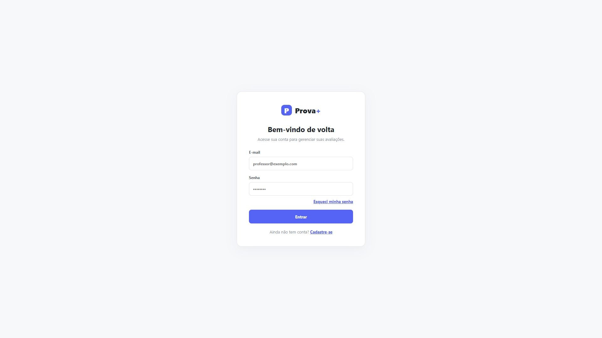

*Entrada do professor.*

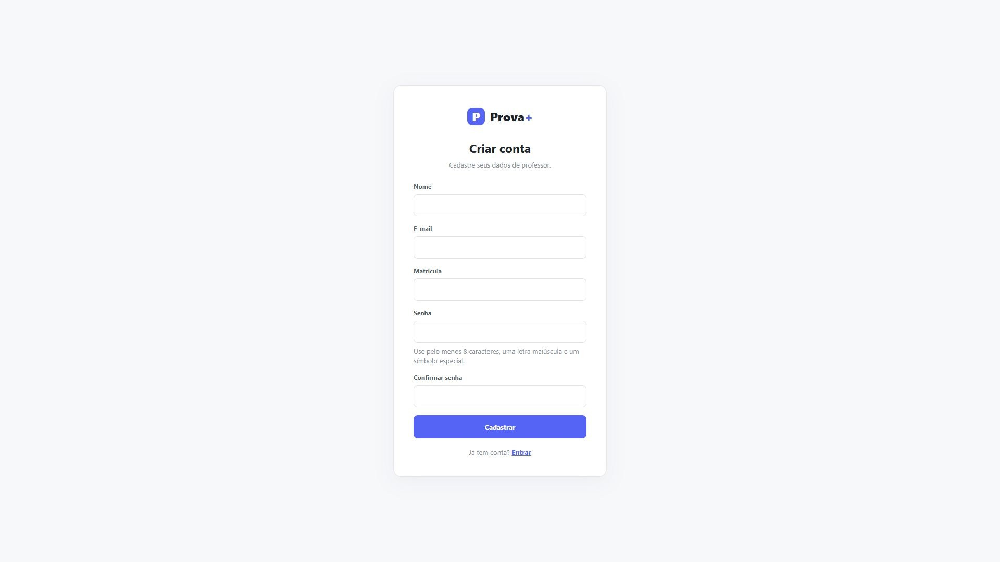

*Dados necessários para criar a conta.*

*Solicitação do link de recuperação; o formulário de redefinição aberto pelo link ainda precisa de nova captura.*

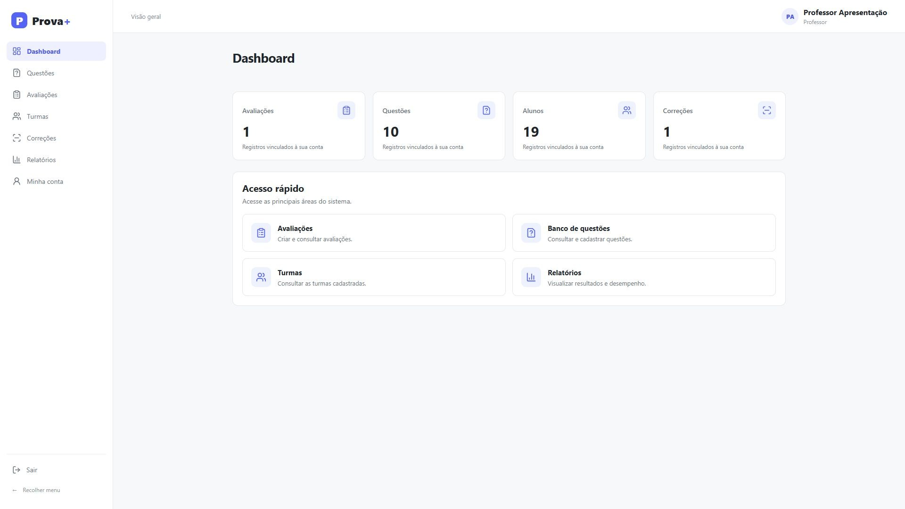

*Área inicial após o login, com indicadores e atalhos.*

## 2. Cadastrar turmas e alunos

1. Abra **Turmas** e a ação de nova turma.
2. Preencha identificação, nome, semestre e disciplina; salve.
3. Na listagem, use a edição para corrigir dados e **Alunos** para administrar os matriculados.
4. Na página de alunos, abra o cadastro, informe nome e matrícula e salve. Também é possível editar ou remover o vínculo com a turma.
5. Remover um aluno da turma mantém o cadastro e o histórico de provas. Desativar uma turma a remove da listagem de turmas ativas.

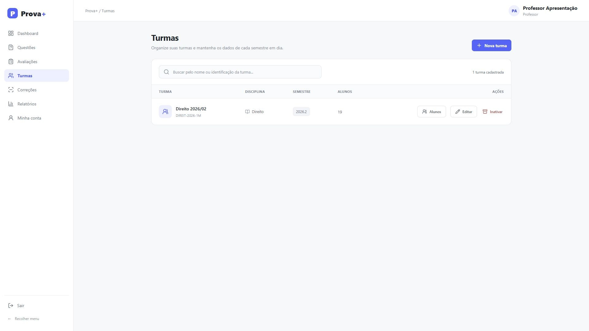

*Listagem de turmas da conta de demonstração.*

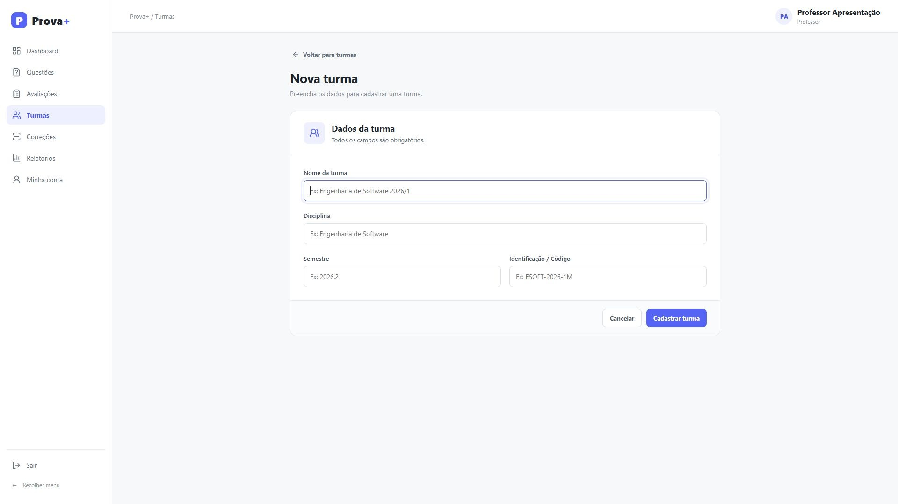

*Formulário de nova turma.*

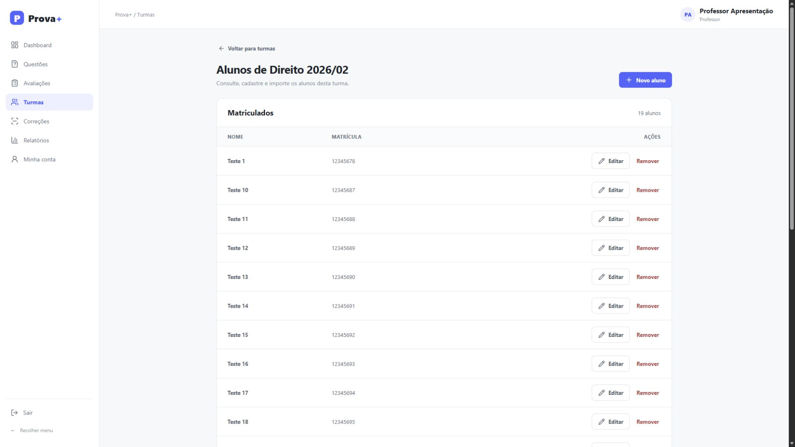

*Listagem com matrículas de teste.*

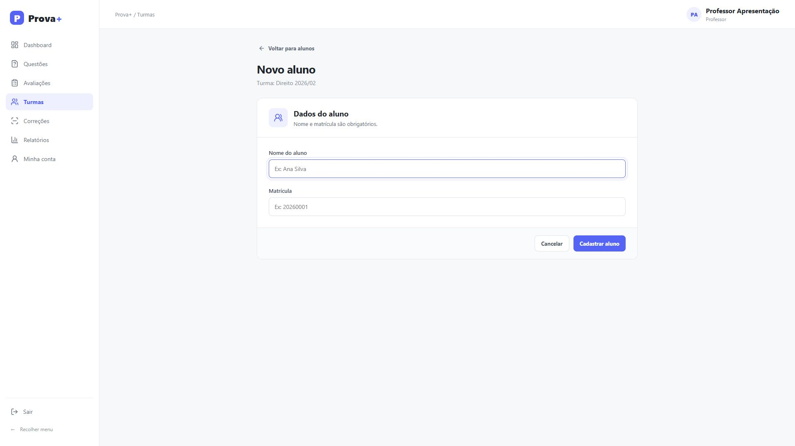

*Formulário de novo aluno.*

Para importar alunos:

1. Na página **Turmas → Alunos**, baixe o modelo Excel.
2. Preencha a primeira aba com as colunas **Nome** e **Matrícula**. Para manter zeros à esquerda, use formato Texto na matrícula.
3. Selecione o arquivo `.xlsx` de até 2 MB e 1000 alunos.
4. Confira a prévia. Corrija linhas com erro antes de confirmar.
5. Confirme a importação. Se houver erro em uma linha, nenhuma linha será importada.

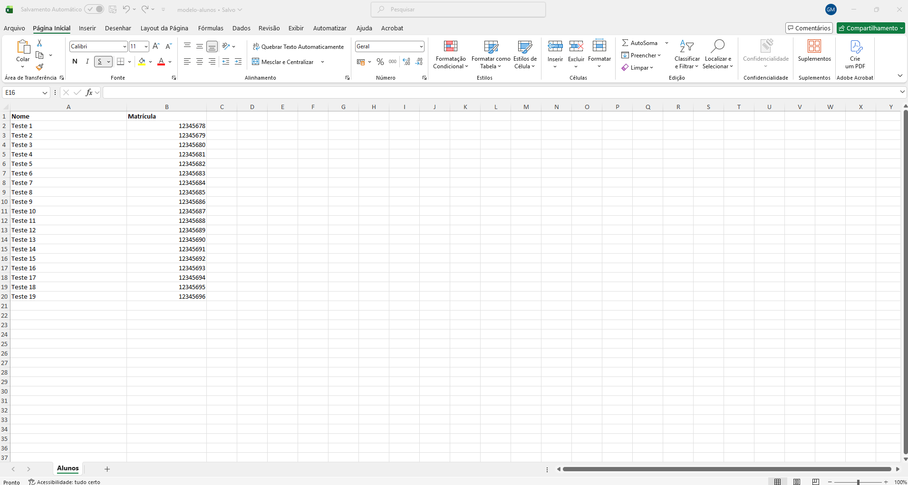

*Modelo da planilha com as colunas Nome e Matrícula preenchidas com dados de teste.*

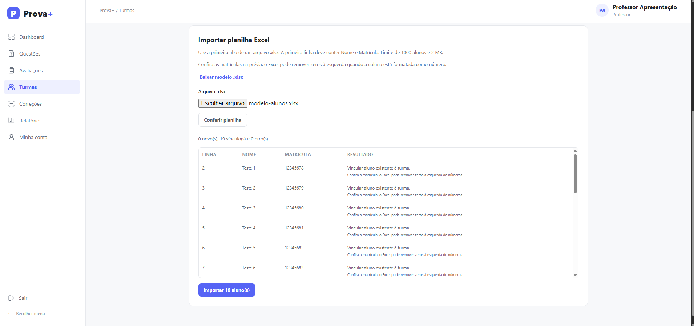

*Prévia das linhas após conferir a planilha. A imagem foi feita antes de confirmar a importação.*

A seção de importação fica abaixo da lista de matriculados. Uma matrícula já vinculada à mesma turma é recusada. O mesmo aluno pode participar de outras turmas da sua conta com o mesmo nome. Matrículas associadas a outro professor não podem ser reutilizadas por esse fluxo.

## 3. Criar e editar questões

1. Abra **Questões** e o formulário de nova questão.
2. Informe o enunciado, a disciplina e as alternativas.
3. Cadastre de duas a cinco alternativas e marque exatamente uma como correta.
4. Salve e confira a questão na listagem.
5. Para ajustar o conteúdo, abra a edição, confira o gabarito e salve novamente.

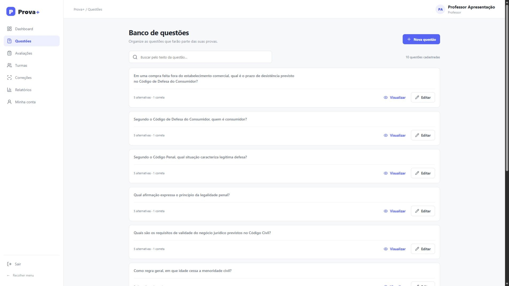

*Questões cadastradas na conta de demonstração.*

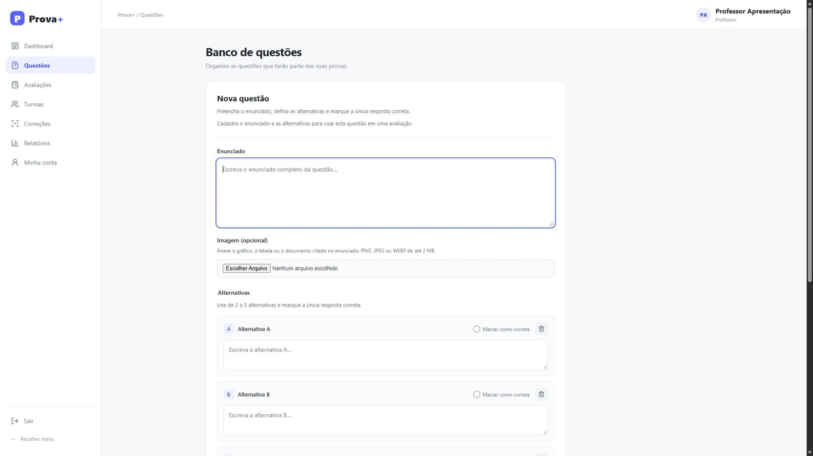

*Cadastro com alternativas e escolha da correta.*

O fluxo persistido usa texto. Versões de prova já geradas guardam seu próprio conteúdo; revise as novas avaliações após alterar o banco de questões.

## 4. Montar uma avaliação

1. Abra **Avaliações → Nova avaliação**.
2. Informe o título e selecione as questões.
3. Configure o embaralhamento de questões e/ou alternativas, se desejado.
4. Salve e abra os detalhes para conferir a composição.
5. Edite a composição antes de gerar uma aplicação. Uma avaliação com aplicação registrada não pode ser editada ou excluída pelo fluxo atual.

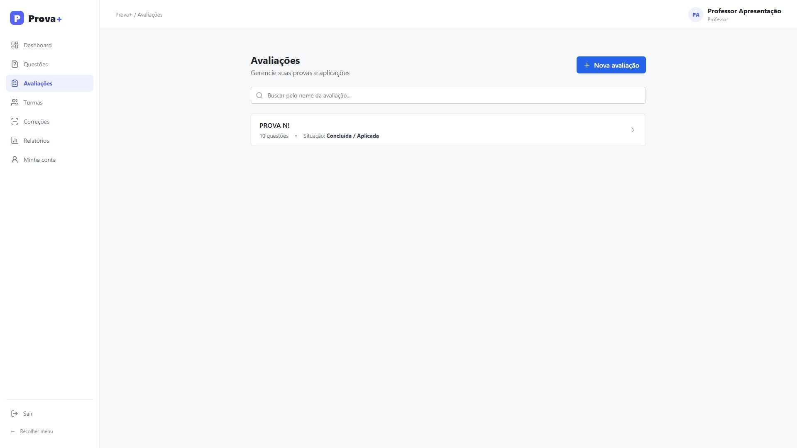

*Listagem das avaliações.*

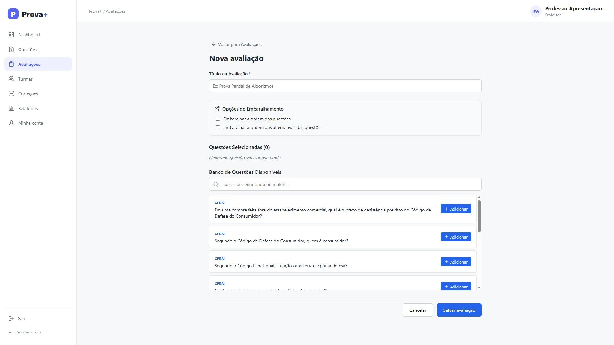

*Composição de uma nova avaliação.*

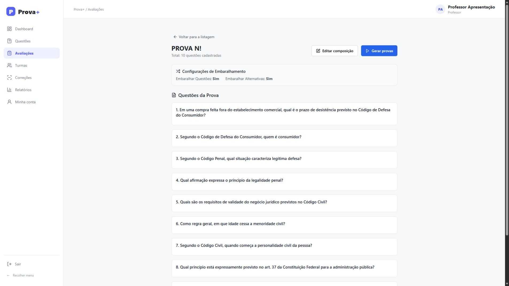

*Questões e configurações da avaliação aplicada.*

## 5. Gerar e baixar as provas

1. Nos detalhes, abra a geração da avaliação.
2. Selecione uma turma ativa que possua alunos.
3. Gere as provas. O sistema cria tantos exemplares quanto o número de alunos matriculados.
4. Confira as prévias das versões e baixe o lote em DOCX.
5. Abra o arquivo no Word ou editor compatível e confira a paginação antes de imprimir.

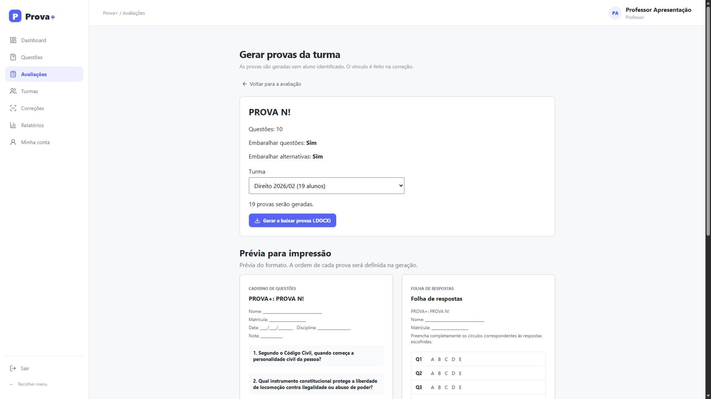

*Turma escolhida, quantidade prevista e início da prévia. A captura foi feita antes de gerar um novo lote.*

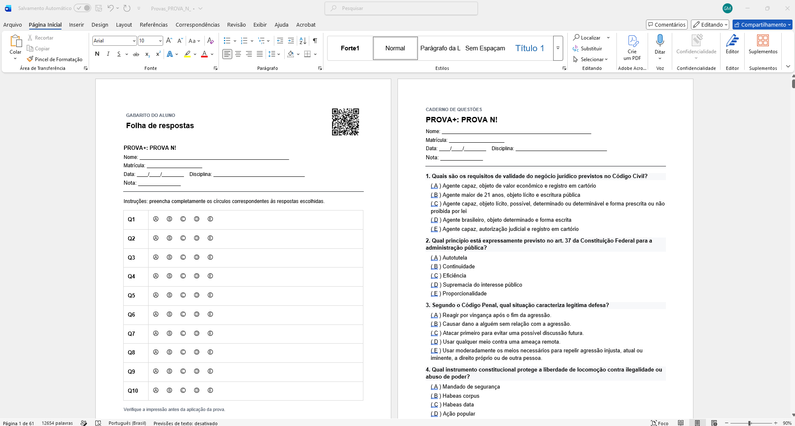

*DOCX aberto no Word, mostrando a folha de respostas com QR e o início do caderno de questões. Confira todas as páginas antes de imprimir.*

Cada exemplar possui um QR individual e conteúdo salvo na ordem gerada. Os exemplares são inicialmente anônimos: o vínculo entre aluno e versão é feito ao salvar a correção.

## 6. Identificar e corrigir uma prova

1. Abra **Correções** e selecione a avaliação.
2. Inicie a leitura e permita o uso da câmera.
3. Aponte a câmera para o QR da folha. Se ele pertencer a outra avaliação, confira a seleção.
4. Confira a prova identificada.
5. Informe a alternativa de cada questão; quando necessário, marque **Branco** ou **Rasura**.
6. Para salvar, selecione a turma e identifique o aluno cadastrado.
7. Solicite o cálculo e confira a nota, os acertos e os erros.

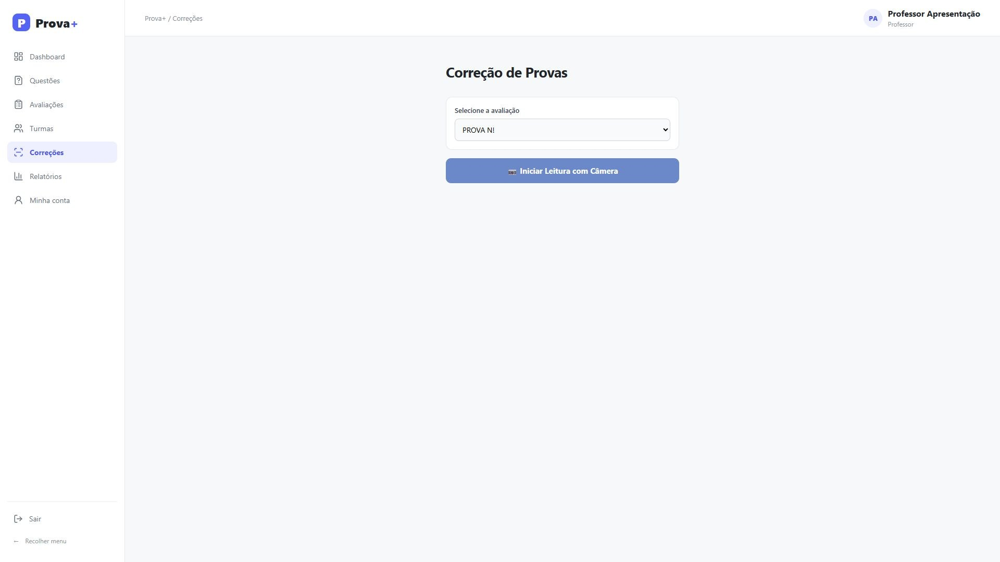

*Estado anterior à leitura pela câmera. A câmera em funcionamento ainda precisa de captura atual.*

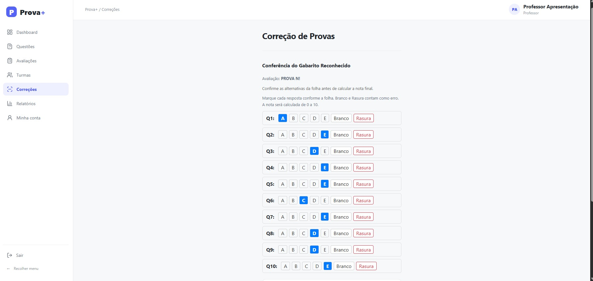

*Respostas selecionadas para conferência antes do cálculo da nota.*

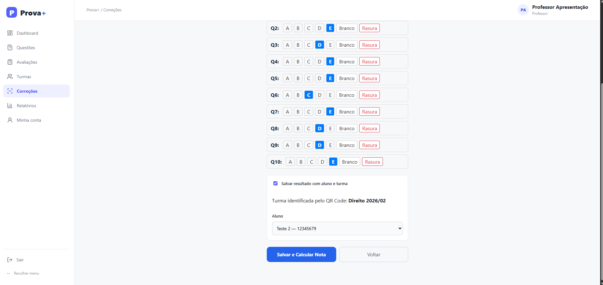

*Parte inferior do formulário: aluno identificado e ação para salvar e calcular a nota.*

**A câmera lê o QR, mas não reconhece as alternativas preenchidas no papel.** A conferência das respostas é manual nesta versão. Questões pendentes ou ilegíveis precisam ser resolvidas antes do cálculo. A nota vai de 0 a 10, com pesos iguais; branco e rasura contam como erro.

## 7. Consultar o resultado e a liberação

O resultado mostra a nota e o detalhamento por questão.

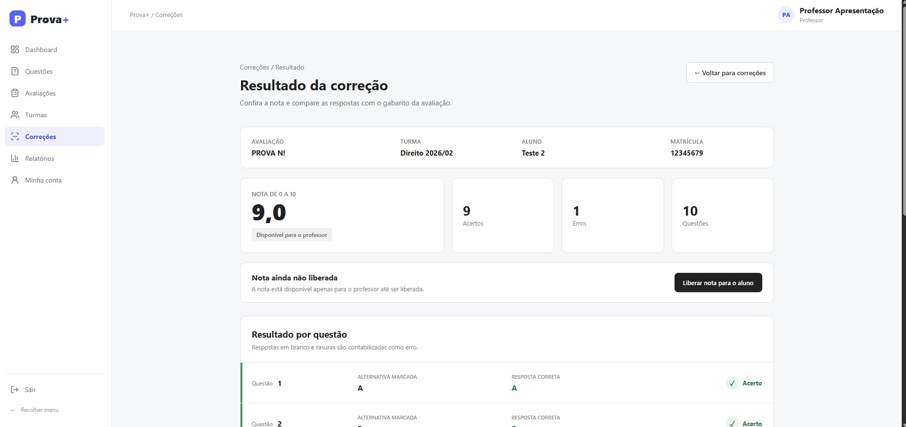

*Resultado salvo de teste, com nota, acertos, erros e início do detalhamento por questão. A parte inferior ainda precisa de captura atual.*

## 8. Consultar relatórios e exportar notas

1. Abra **Relatórios**.
2. Selecione turma e avaliação.
3. Confira média, maior e menor nota, resultados dos alunos e análise por questão.
4. Use **Exportar notas em Excel** para baixar o XLSX da seleção.
5. Abra o arquivo e confira matrícula, aluno, turma, avaliação, nota, acertos e erros.

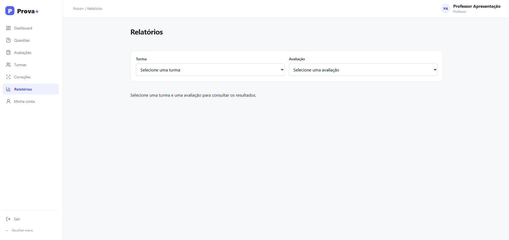

*Estado inicial, antes de selecionar turma e avaliação.*

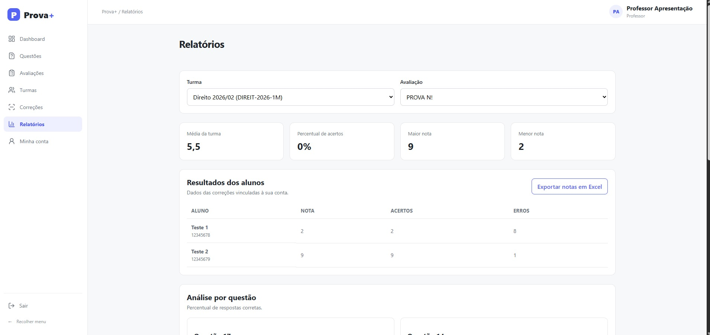

*Turma e avaliação selecionadas, com indicadores e resultados de dois alunos de teste.*

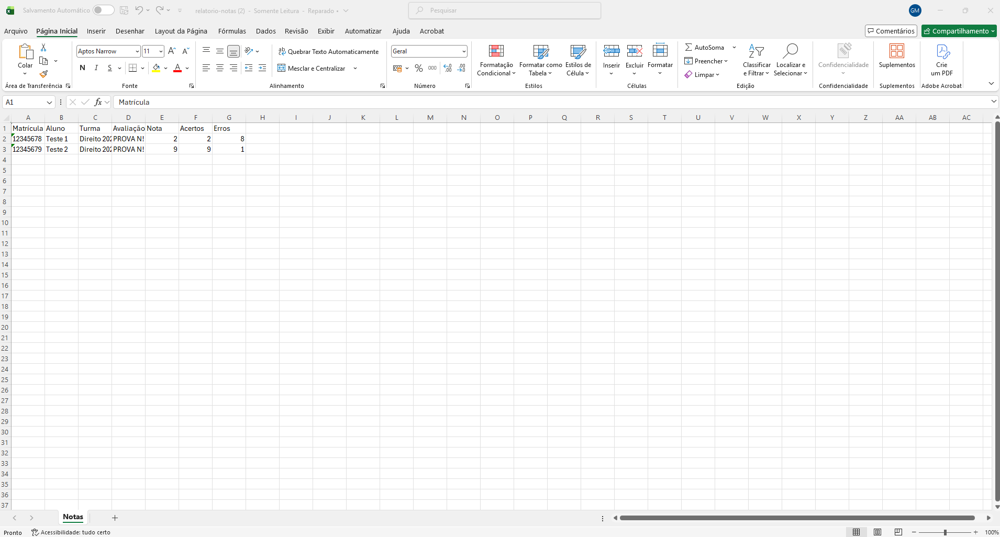

*XLSX aberto no Excel com matrícula, aluno, turma, avaliação, nota, acertos e erros.*

Sem correções salvas para os filtros, a tela informa que não há resultados. A exportação atual contém notas e totais; não inclui uma coluna por resposta. Os percentuais por questão usam as alternativas persistidas e precisam de revisão para incluir corretamente brancos e rasuras.

## 9. Problemas comuns

| Situação | Como proceder |
| --- | --- |
| Não foi possível conectar à API | Confira a conexão e tente novamente; o responsável pelo ambiente deve verificar a API. |
| Sessão encerrada | Entre novamente. Alterar senha ou desativar conta invalida sessões existentes. |
| Câmera indisponível | Confira permissão no navegador e se outra aplicação está utilizando a câmera. |
| QR rejeitado | Confira a avaliação selecionada e a folha usada; não prossiga com uma identificação incorreta. |
| Turma sem alunos | Cadastre ou importe os alunos antes de gerar as provas. |
| Importação com erro | Corrija as linhas apontadas na prévia e reenvie o arquivo. |
| Relatório vazio | Confira os filtros e se a correção foi salva com aluno identificado. |

[Voltar ao README](../README.md)
